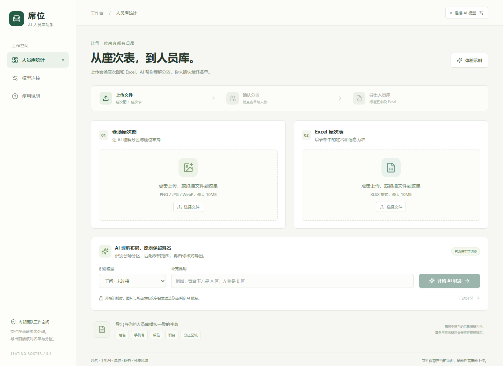
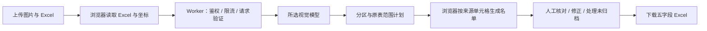

# 席位 · AI 人员库助手

上传一张会场座次图和一份 `.xlsx` 座次表，识别分区，核对名单，再导出人员库。适用于个人和内部活动团队。



导出字段固定为：**姓名、手机号、单位、职务、分座区域**。一张表内每格一人的座次网格和一行一人的名单都可以处理；缺失字段留空。原表重名和括号备注保留，并提示人工确认。图片座位容量与名单人数不一致时提醒，不会为了匹配容量删人。

## 架构选择

推荐 **React + TypeScript + Cloudflare Workers Static Assets**：同一个域名提供静态网页和 `/api/*`，GitHub 提交后由 Cloudflare Builds 部署。Cloudflare 目前推荐新项目使用 Workers Static Assets，Pages 仍可使用，项目也提供 Pages Functions 入口。



**AI 只判断区域与来源范围，程序负责读取原始姓名和统计。** AI 无法直接生成新姓名或用改写后的姓名替换原表。每条记录使用 `工作表!单元格` 作为来源 ID；名单里的人工修改通过该 ID 关联，重名也能各自保留。

人工分区调整使用稳定的分区 ID，重命名后名单和导出会使用最新名称。删除分区或调整来源范围时会清理失效的人工归属，保留其他字段修改；有当前来源的记录按来源归属，其余回到未归档列表。名单的非姓名列不能手动生成额外人员，未使用的信息仍保留供核对或忽略。

Excel 导入支持整数补零格式（例如 `00000000000`），数字和已缓存的公式结果都会保留前导零；导出的手机号继续保存为文本。日期、金额等其他数字格式保持原有读取方式。

初版采用无状态架构：表格文件、原图和人员名单不写入网站数据库或对象存储；刷新页面会清空本次工作。开始 AI 识别时会将处理后的图片、所选工作表文字及补充说明发送至所选供应商。手动分区和示例流程不发送到模型。供应商自己的处理与保留规则以其服务条款为准。

## 已实现

- 图片拖拽上传、浏览器内缩放与压缩；Excel 上传和工作表选择。
- 千问、DeepSeek、智谱、OpenAI、Claude 五种服务端适配。
- 分区图片对照、人数 / 容量核对、重名与姓名备注提醒。
- 编辑分区名称、图片容量、Excel 来源范围，切换网格 / 名单模式。
- 编辑五字段、移动分区、排除记录与恢复。
- 未归档单元格处理，重叠范围及不存在的引用检查。
- 搜索、分区筛选、分页；导出始终包含核对后的完整名单。
- 固定五字段 Excel 下载，手机号以文本保存；文本不会写为公式。
- 团队访问口令、服务端密钥、请求尺寸限制、Workers 分布式近似限流。
- 纯示例体验、使用说明、手机布局、GitHub CI、两种 Cloudflare 配置。

## 本地体验

需要 Node.js 24（或兼容的 Node.js 22.12+）。

```bash
npm ci
npm run dev
```

打开终端显示的网址，点击「体验示例」即可核对、编辑和导出。也可以上传真实 Excel 后选择「手动分区」，无需 API 密钥。

使用 AI 时：

1. 将 `.dev.vars.example` 复制为 `.dev.vars`。
2. 填入一个随机、至少 16 位的网站访问口令 `APP_ACCESS_TOKEN`。
3. 填入至少一个供应商的 API 密钥。模型与 API 地址可按账户权限和地域覆盖。
4. 在第二个终端执行：

```bash
npm run build
npm run dev:api
```

保持两个终端运行。前端开发服务器将 `/api` 请求代理到 `127.0.0.1:8787`。在网页「模型连接」填写网站访问口令，验证后选择已启用的模型。

访问口令只保存在当前页面内存中。真实 AI 密钥只在 `.dev.vars` 或 Cloudflare Secrets 中，禁止写入 `VITE_*` 变量或提交到 GitHub。

## 模型配置

只需要配置你打算使用的供应商，其余选项会显示未连接。网页不接收任意 API 地址或模型名；管理员在服务端配置，避免前端随意改变计费模型。

| 供应商           | 密钥 Secret         | 默认视觉模型示例    | 协议                         |
| ---------------- | ------------------- | ------------------- | ---------------------------- |
| 千问             | `QWEN_API_KEY`      | `qwen3-vl-plus`     | OpenAI 兼容 Chat Completions |
| DeepSeek         | `DEEPSEEK_API_KEY`  | `deepseek-flash`    | OpenAI 兼容 Chat Completions |
| 智谱             | `ZHIPU_API_KEY`     | `glm-5.3-flash`     | OpenAI 兼容 Chat Completions |
| ChatGPT / OpenAI | `OPENAI_API_KEY`    | `gpt-5.4-mini`      | Responses + JSON Schema      |
| Claude           | `ANTHROPIC_API_KEY` | `claude-sonnet-5-5` | Messages + 结构化工具调用    |

配置覆盖：`QWEN_MODEL` / `DEEPSEEK_MODEL` / `ZHIPU_MODEL` / `OPENAI_MODEL` / `ANTHROPIC_MODEL`。地址覆盖对应 `*_BASE_URL`。Claude 默认使用 `ANTHROPIC_VERSION=2026-10-21`，管理员可按自己的接口版本修改。

示例默认值按 **2026-11-13 官方文档**选择，账户可用性和后续模型更新需要管理员确认。选择其他模型时必须确认它支持图片输入。这里的 ChatGPT 和 Claude 是各自平台的 API 接入，需要对应 API 凭据与可用额度。

千问默认保留仍然可用的北京兼容域名；新账户建议设置自己的工作空间域名，例如 `https://你的工作空间ID.cn-beijing.maas.aliyuncs.com/compatible-mode/v1`，地域要与密钥对应。

## 上传 GitHub 与连接 Cloudflare（推荐 Workers）

1. 在 GitHub 创建仓库，建议内部工具使用私有仓库。上传本项目的源文件及 `package-lock.json`。不要上传 `node_modules`、`.dev.vars`、`dist` 或真实会议资料。
2. Cloudflare 控制台进入 **Workers & Pages → 创建 Worker → 导入 Git 仓库**，授权并选择该仓库。
3. 项目根目录设为仓库根目录，构建命令设为 `npm run build`，部署命令设为 `npx wrangler deploy`，Node 版本使用 24。安装依赖使用 `npm ci`。
4. 第一次部署后，在该 Worker 的运行时 Variables / Secrets 中设置 `APP_ACCESS_TOKEN` 和至少一个供应商 API Key。API Key 和口令选择 **Secret** 类型；模型名称与服务地址可用普通变量。设置后重新部署。
5. 打开 `workers.dev` 地址，连接模型并测试上传与导出。
6. 在 Worker 的 **Settings → Domains & Routes → Add Custom Domain** 添加你的域名。域名 DNS 需由对应 Cloudflare 账户管理。可以另加 Cloudflare Access 限制仅团队成员打开网站；应用接口仍保留访问口令验证。

此后推送 GitHub，Cloudflare Builds 会更新网站。仓库自带的 GitHub Actions 只做检查，避免与 Cloudflare 的自动部署重复。

也可用 CLI 首次部署：

```bash
npx wrangler login
npm run deploy
npx wrangler secret put APP_ACCESS_TOKEN
npx wrangler secret put QWEN_API_KEY
```

密钥配置命令交互输入真实值；其他供应商按上表的 Secret 名称设置。部署之前可先运行 `npm run deploy:dry`，它只编译和检查，不发布。

`wrangler.jsonc` 中 `namespace_id="1001"` 是限流命名空间示例。账户已有相同 ID 时，可改为独立的正整数字符串，避免与其他项目共享计数。默认同一团队每个 Cloudflare 地点约每分钟 6 次 AI 分析，属于近似限流，不是严格全球预算。供应商控制台也应设置适合团队的费用上限。

## Pages 部署方式

项目的 `functions/api/[[path]].ts` 使用同一个 API 处理器，无需单独搭一个跨域 Worker。

CLI 路线：

```bash
npm run pages:deploy
```

它显式使用 `wrangler.pages.jsonc`，将 `dist` 静态页面和 Functions 一起部署。Pages 项目需要先在 Cloudflare 创建或按 Wrangler 提示选择。Secrets 在 Pages 项目的 Production 环境配置。

如果希望 **Pages 直接连接 GitHub 自动构建**：为 Pages 建独立分支，将 `wrangler.pages.jsonc` 的内容作为该分支根目录的 `wrangler.jsonc` 提交。根目录选择仓库根目录，构建命令 `npm run build`，输出目录 `dist`。Pages 会自动编译 `functions/`。该分支用于 Pages，Workers 分支继续保留原来的 Worker 配置。

Pages 配置没有 Workers 限流绑定；该路线请在 Cloudflare WAF 配置 `/api/analyze` 的限流规则，也建议使用 Cloudflare Access。应用的口令校验、文件验证和服务端密钥仍然生效。Preview 环境应使用测试凭据或不配置 AI 密钥。

## 验证与限制

```bash
npm run check
npm run deploy:dry
npm run pages:check
```

自动测试使用合成数据，覆盖实际 XLSX 读写、242 条记录 / 212 座的容量冲突、重名、括号备注、漏分、手动修正、来源重叠、名单字段与手动归档冲突、分区重命名和删除、补零格式的导入导出、合并格、缓存公式、格式错误、鉴权、限流和五家供应商协议。仓库不包含真实参会名单或私人截图。

AI 协议测试使用模拟响应，**不能证明真实 API 账户已经开通或模型的识别质量**。首次部署后需用实际配置的 API 做一次会场图片和表格的验收。无 API 凭据时，演示与手动整理可完整使用。

单个上传文件最大 10MB；选中工作表合计最多 4000 个非空单元格、500000 个字符；每表最多 1000 行、200 列、每格 512 字符，最多 20 张非空工作表。XLSX 解压大小声明合计限制 64MB。未保存缓存结果的公式需要在 Excel 重新保存。图片最长边会限制到 2560 像素；小字不清时请上传裁剪后的清晰座次图。一次 AI 请求 90 秒超时，失败可换模型或手动处理。

大文件、历史项目保存、多用户权限和严格全球调用预算是后续扩展：历史文件可用 R2，项目元数据用 D1，长任务用 Workflows / Queues，全局预算用 Durable Objects。当前团队场景无需这些存储和任务组件。

## 代码入口

| 位置                        | 作用                           |
| --------------------------- | ------------------------------ |
| `src/App.tsx`               | 上传、核对、编辑、导出页面     |
| `src/lib/roster.ts`         | 原表坐标读取、统计、覆盖检查   |
| `src/lib/excel.ts`          | 浏览器 XLSX 解析与固定字段导出 |
| `src/lib/schema.ts`         | 统一输入、分区计划与五字段定义 |
| `worker/providers.ts`       | 五家模型适配、提示词和配置     |
| `worker/api.ts`             | 口令校验、限流与请求验证       |
| `worker/index.ts`           | Workers 路由                   |
| `functions/api/[[path]].ts` | Pages Functions 路由           |

## 官方参考

- [Cloudflare Workers 新项目建议](https://developers.cloudflare.com/workers/best-practices/workers-best-practices/)、[Static Assets](https://developers.cloudflare.com/workers/static-assets/)、[Pages Functions 配置](https://developers.cloudflare.com/pages/functions/wrangler-configuration/)、[限流绑定及其近似性](https://developers.cloudflare.com/workers/runtime-apis/bindings/rate-limit/)
- [OpenAI 图片输入](https://developers.openai.com/api/docs/guides/images-vision)、[结构化输出](https://developers.openai.com/api/docs/guides/structured-outputs)、[GPT-5.4 mini](https://developers.openai.com/api/docs/models/gpt-5.4-mini)
- [千问视觉兼容接口](https://www.alibabacloud.com/help/en/model-studio/qwen-vl-compatible-with-openai)、[DeepSeek Vision](https://api-docs.deepseek.com/guides/vision/)、[智谱 GLM-5.3-Flash](https://docs.bigmodel.cn/cn/guide/models/vlm/glm-5.3-flash)、[Claude 图片输入](https://platform.claude.com/docs/en/build-with-claude/vision)、[Claude Messages](https://platform.claude.com/docs/en/api/messages/create)
